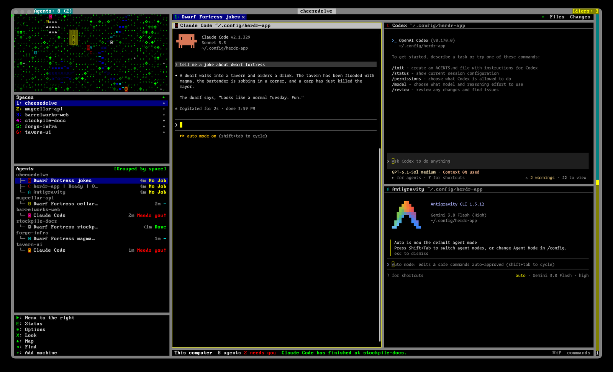
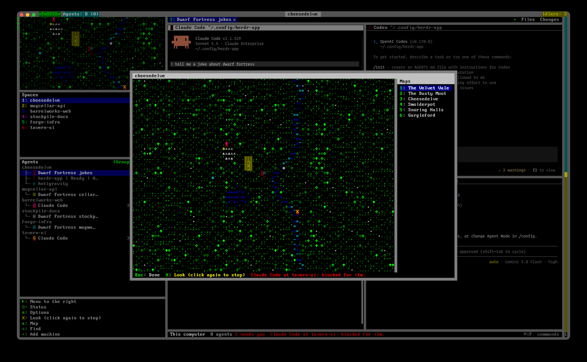
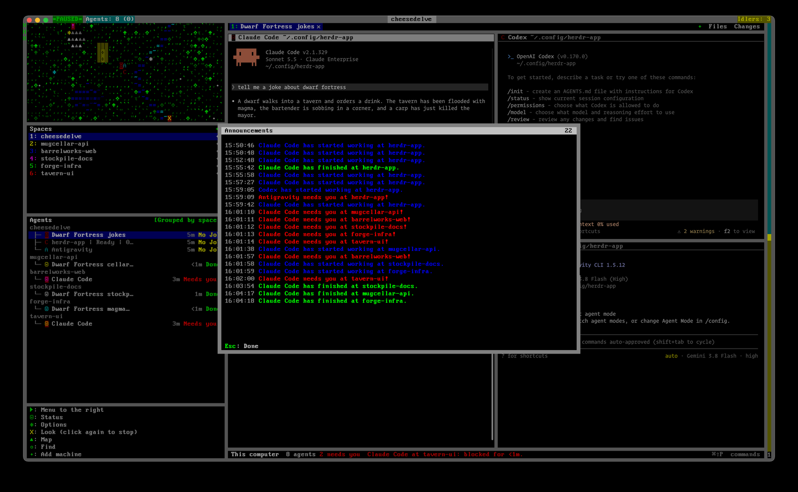
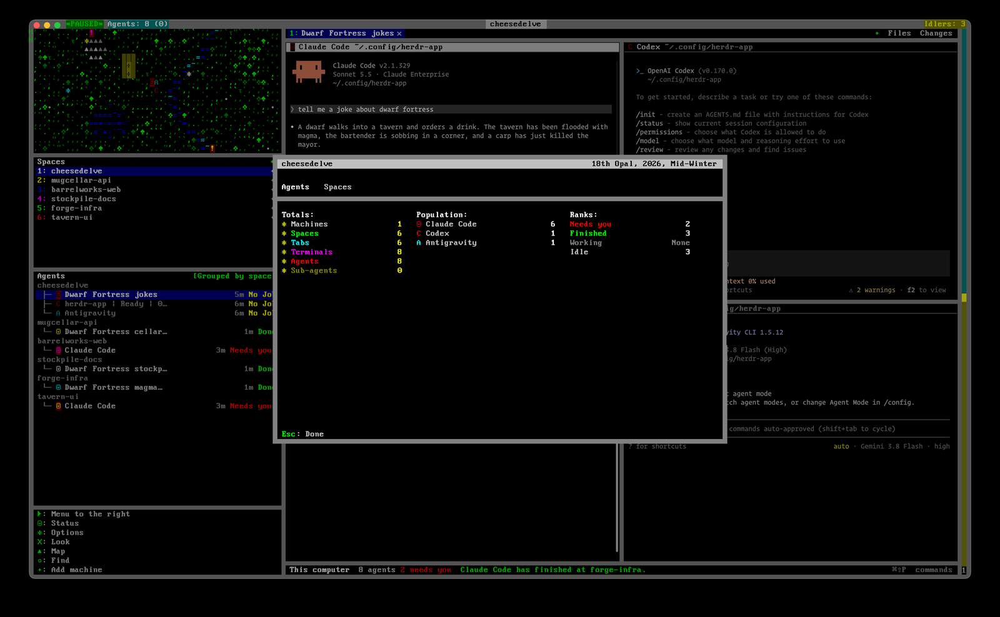

# Dwarf Fortress Classic (a Herdr layout)

Herdr drawn as classic ASCII Dwarf Fortress: a black grid with a gray frame, the 16 DF colors, and code page 437 glyphs. Agents are creatures walking a small map (six to choose from), spaces and agents are menus written the way the game writes them, and what your agents do shows up as announcements.



|                                                      |                                                             |
| ---------------------------------------------------- | ----------------------------------------------------------- |
|    |  |
|  |                                                             |

## Install

Copy the three folders into your Herdr home (`~/.config/herdr-app`), keeping their names, then switch layout (`ctrl-shift-l`, or `herdr-app do layout.switch --name df-classic`):

```sh
cp layouts/df-classic.json ~/.config/herdr-app/layouts/
cp themes/df-classic.json  ~/.config/herdr-app/themes/
rsync -a --exclude RECIPE.md --exclude "preview*.png" mods/df-classic ~/.config/herdr-app/mods/   # recipe and previews stay in the repo
herdr-app check ~/.config/herdr-app/mods/df-classic
```

If a name is already taken, rename the layout file, the theme, the mod folder and the `df-classic` names inside the layout and the mod's own paths.

## For an agent installing it

Follow the platform manual's steps (`~/.config/herdr-app/AGENTS.md`, "Layouts and mods other people made"). Read `mods/df-classic/RECIPE.md` (in this repo; the install leaves it out) and every file first, and tell the person what the mod touches before adding it: it runs `git` and `hc`, watches the folders of their spaces, writes only its own layout file (to move the menu side), keeps shared state under `df.*`, and uses no network (`mods/df-classic/README.md`, "What it touches"). `scripts/install-to-herdr.sh` does the copying without overwriting. Then `herdr-app check`, and `herdr-app do layout.switch --name df-classic`; `ctrl-shift-l` switches back.

## What is in here

- `RECIPE.md` and `preview.png`: the brief to rebuild it, and its picture (copies of the ones in the mod folder, at the root where herdr.dev's gallery reads them).
- `LICENSE`: MIT for the code and docs; the font and tileset keep CC BY-SA 4.0 (see "License" below).
- `AGENTS.md` and `CLAUDE.md` (which imports `AGENTS.md` and Herdr's own manual): notes for an agent changing it. `DEVELOPMENT.md`: how this repo and a live Herdr stay in step. `scripts/`: `deploy-to-herdr.mjs` (repo into the Herdr home), `sync-from-herdr.sh` (pull an app-made change back), `install-to-herdr.sh`, the scans and `sync-gallery-copies.sh`, with their tests. `.claude/`: the hooks that run the deploy and the checks.
- `layouts/df-classic.json`: the window.
- `themes/df-classic.json`: the colors.
- `mods/df-classic/`: the code, the tileset, the fonts, and the docs: `README.md` (what each file does), `RECIPE.md` (the brief to rebuild it), `SYMBOLS.md` (the game's glyphs and which this layout draws), `AGENTS.md` (rules for changing it).

Working on it? See `DEVELOPMENT.md` for how the repo and a live Herdr stay in step (`scripts/deploy-to-herdr.mjs`, `scripts/sync-from-herdr.sh`, `scripts/install-to-herdr.sh`).

Tests for the pure modules: `cd mods/df-classic && node --test ".tests/*.test.mjs"`.

## License

The code, the layout and theme files and the docs are MIT (`LICENSE`). Two parts carry other terms, and keep them:

- **The font and the tileset** (`mods/df-classic/fonts/`, `tileset/`, `art/PxPlus9x16.png`) are the PxPlus IBM VGA font by VileR, or drawn from it, under CC BY-SA 4.0. See `mods/df-classic/fonts/NOTICE.md`. Reusing the tileset means keeping that credit and license.
- **Facts from the Dwarf Fortress Wiki** (the workshop grids in `art/wiki_workshop_grids.json`, and the glyph table in `SYMBOLS.md`) come from pages offered under GFDL and MIT; the sources are named in `SYMBOLS.md`.

## Credits

The tileset is drawn from the PxPlus IBM VGA font (CC BY-SA 4.0), see `mods/df-classic/fonts/NOTICE.md`. Glyph meanings follow Dwarf Fortress as documented by the community; sources are in `mods/df-classic/SYMBOLS.md`. This is a fan layout, not made by or affiliated with Bay 12 Games or Kitfox Games.
