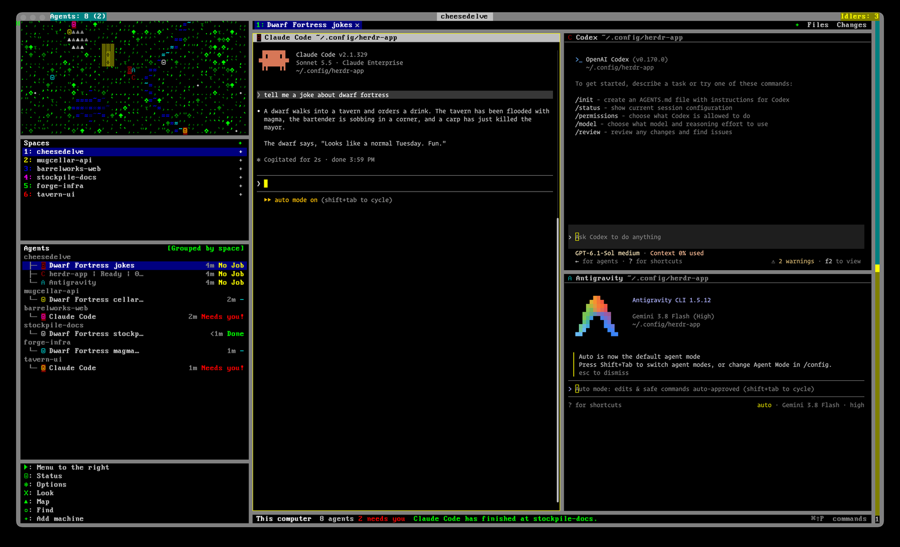

# Dwarf Fortress Classic

Herdr drawn as classic ASCII Dwarf Fortress: a black grid with a one-tile gray frame, the 16 DF colors, and CP437 glyphs for everything that is not text. Agents are creatures walking a small outdoor map; spaces, agents, tabs and pane headers are rows of colored text written as the game writes its menu.

## What you see

Everything sits on 18 px text rows and 9 x 16 px glyph tiles. Chrome text is the bundled PxPlus IBM VGA 9x16 (`ui_font`, size 16); terminals keep the person's own terminal font. Background `canvas` (the frame, black `#000000` in the theme), text light gray `#c0c0c0`.

Left to right, a 9 px left border (`reports`), the shell, a 9 px right border. The shell, top to bottom:

1. **Top border, 18 px.** `*PAUSED*` (light green on green) only while no agent works; `Agents: N (W)` (white on cyan); the active space's name centered, black on light gray; `Idlers: N` (yellow on brown) at the right. Window buttons appear here only where the system draws none; on macOS the traffic lights sit over it. Dragging it moves the window.
2. **Body**, a row with 8 px dividers:
   - **Menu column, 324 px, background `chrome`.** From top: the **map** (224 px, 14 glyph rows, taller by dragging the line under it, 96 to 640 px); **Spaces** and **Agents** lists sharing the rest; the **footer** (126 px, 7 rows, locked).
   - **Work area.** A tab row (18 px), then the shown tab's panes with a one-row header each, then (hidden until opened) a 368 px panel with the shipped Files and Changes; at the bottom an 18 px **status line**.
   - **Depth bar, 9 px**, the last column: one level per tab of the active space.
3. **Bottom border, 8 px.**

**Spaces list.** `1: name branch` then a `+` at the end of the row, in the same gray as the name. The shown space is a white-on-blue bar; hover is teal. Agent counts and status marks follow the shipped `spaces` mod's logic.

**Agents list.** Each row starts with the agent's map glyph. Grouped by space it draws `├─` and `└─` connectors in dark gray; sub-agents sit under their parent as `d` or `c`.

**Footer.** Green glyph marks (not keys): `►`/`◄` menu to the other side, `☺` Status, `☼` Options, `X` Look, `▲` Map, `○` Find, `+` Add machine.

**Left border: report letters.** Starting one tile below the top, newest first: red `C` an agent needs you, light green `H` an agent finished, light blue `S` an agent started work. Each lasts 90 s, at most 12; click one to go to that agent.

**Map.** One of six fixed scenes, named in the game's whimsical way in the menu (The Velvet Vale, The Dusty Moot, Cheesedelve, Smolderpot, Snoring Halls, Gurgleford), each 96 x 40 cells and the same every time, picked by a right-click on the sidebar's map, or from the list of maps down the right side of the big map (shared `df.map`, default the meadow); a click on the sidebar's map opens the big map: the **meadow** (grass, shrubs, saplings, trees in patches, boulders, a brook, a pond, a rocky outcrop and a clearing), the **settlement** (a walled frontier town on dry plains, not the meadow's ground: dirt, scrub, boulders, a few dead trees, ploughed fields outside; a cobbled plaza with a well and market stalls at the crossing of two streets, a tavern with tables, a smithy and a shop with workbenches, a barn of hay and four houses with beds, all packed toward the middle inside a log palisade with a gate on each street; walls in double-line box characters) and the **fortress** (rooms outlined by shaded-block walls in blank rock, packed toward the middle: a great hall with a statue and pillars, a cavern hall around a chasm that is the open space of the level below, a stair room, a dining hall with tables and chairs, bedrooms, barracks, workshops and a smithy with forges, a stockroom; stairs and the ramp up are drawn but not walkable). the **volcano** (seen from the rim of its crater: a ledge of ash edged by slopes, inside it dim red magma on the level below that cannot be walked, a stone island at the rim's level with two magma forges, a craftsdwarf's workshop, a magma smelter and four statues, joined by four double-line-outlined bridges, dim out-of-reach plains outside), the **mountainside** (autumn woods on the left; on the right blank rock outlined by a wall, with one door in its face, a hallway east and a second across it, 28 bedrooms of 3 x 3 with a bed, a cabinet and a chest each) and the **river** ("Gurgleford": a conifer forest on a ridge of three levels seen from the middle one, the only walkable level: blank rock outlined by a wall to the north with a waterfall off it, dim out-of-reach lower ground to the south with a second waterfall off the middle level's edge, a 3-wide brown road over the river on an outlined bridge floored with `+`, small hills of slopes with blank rock inside, a one-room cabin with a bed, cabinet, chest, table and two chairs north of the road, west of the bridge). The meadow also has the embark wagon: 3 x 3, hatched brown `▓` with `÷` in black on brown down the middle. Workshops are the wiki's 3 x 3 grids (`workshops.js`). The panel shows the part around the map's meeting place that fits.

## How it behaves

- **Agents as creatures.** Claude Code agents are dwarves (`☺`); any other program is its first letter. Each agent keeps one bright color for as long as it lives (`LCYAN`, `YELLOW`, `LMAGENTA`, `WHITE`, `LRED`); two agents of one species do not share one while any is free. Same glyph and color on the map, in the agents list and in the pane header.
- **working:** the creature walks, two cells a second (idle ones one), between trees, boulders and the brook (or a workbench or table on the other maps), lingering 1 to 4 steps at each. The spinner `- \ | /` marks it in lists.
- **idle:** walks to the meeting place and stands, in the dark half of its color; now and then (about one second in fifty) it strolls up to two cells away, looks about for 2 to 5 steps, and walks back.
- **blocked:** stops on a red cell, blinking with `!`. The announcement line says `<Program> needs you at <space>!` in light red while it is blocked.
- **done:** stops, blinking with `☼`. Announced when Herdr says `done` (finished out of sight), and also when work ends in a pane that is shown but does not have the focus (Herdr sends no `done` there; the mod treats working to idle as finished). Work that ends in the focused pane says nothing. `<Program> has finished at <space>.` in light green until that agent works or needs you again.
- **Announcements list:** a click on the announcement line opens a dialog of everything said, oldest at the top, opened at the newest, time in dark gray then the text in its color. Needs-you, started-working and finished lines, memory only, 200 lines.
- **started working:** `<Program> has started working at <space>.` in light blue while it works. An agent already working when the window opens is not announced.
- The focused agent is drawn inverted. No two creatures share a cell. Sub-agents with no pane stand beside their parent as pets in its dark color.
- **Click** a creature: go to its pane (a sub-agent: peek it). A spaces row: select the space. A report letter: go to the agent.
- **A space row's `+`** opens a menu (Terminal, each installed agent, New space, New worktree, Open worktree) with a **Panel | Tab** switch at the top, kept across restarts. Panel (default) opens the new terminal or agent as a pane split to the right of the shown tab's last terminal; Tab opens a tab.
- **Map** (footer): a dialog with the whole world (882 x 694 px), a second copy of the map role. It shares one scene with the sidebar map (`scene.js`), so the same creatures stand in the same places; while it is open the creatures may walk across the whole world, and back inside the sidebar's view some seconds after it closes. It has its own Look switch and shows Look's text at the bottom, since the announcement line is under the dialog.
- **Look** (footer): turns a cursor on. A click on the map puts a yellow `X` there, blinking with what is under it, and the announcement line says what it is: an agent (program, space, state, how long this window has seen it so), a pet, or the ground. Click Look again to stop.
- **Status** (footer): a dialog styled as the game's status screen. A light gray bar: the space and the game's date at the right (the real month is the game's month, the real day scaled to 28). Sections `Agents` and `Spaces`. Agents: three columns, Totals (machines, spaces, tabs, terminals, agents, sub-agents, each with a `☼` and its value in yellow), Population (programs, glyph, count) and Ranks (Needs you, Finished, Working, Idle, `None` in dark gray at zero). Spaces: a table; a click selects the space. `Esc` closes it.
- Hover is a teal bar; selected is a blue bar with white text; the focused pane's header is black on light gray.
- Dragging the column's edge narrower than 160 px folds it to a 108 px rail, and the `»` under the agents list unfolds it (there is no menu row for it) (spaces and agents show their number and the start of their name, the footer rows only their green marks, labels in tooltips, full names in tooltips); "Menu to the right/left" rewrites the layout file to put the menu on the other side.

## Built from

`layouts/df-classic.json`, `themes/df-classic.json`, `mods/df-classic/` (one mod, `main.js`, that picks a role from `props().role`), plus the shipped mods `files`, `changes`, `menu`, `picker`, `prompt`, `confirm`, `help`, `toast`, `peek`, `worktree`, `machine-add`.

Layout: root `row` (`titlebar: "none"`, `traffic_lights: [8, 3]`, `theme: "df-classic"`, `ui_font: "PxPlus IBM VGA 9x16"`, `background: "canvas"`, `terminal_padding: [8, 9]`, no `font` so terminals keep the person's) with children `reports` (9 px), `shell` (column) and `frame-right` (9 px, role `border`). `shell`: `top` (18 px, `window_drag`), `body` (row, divider 8 `canvas`), `bottom` (8 px, role `border`). `body`: `sidebar` (column, 324 px, min 44, max 480, `chrome`, resizable so the map's height can be dragged: `map` 224, min 96, max 640, `sidebar-lists` with `spaces` and `agents` weight 1, `sidebar-footer` 126, min and max 126 so it cannot be dragged), `work` (column: `tabs` 18, `work-body` row gap 8 with `main` = `{tab: "active"}` and a hidden 368 px `panel` stack holding `files` and `changes`, then `status` 18), `depth` (9 px). Pane frame: gap 8, radius 0, header role `pane` 18 px always shown, focus border 1 px `accent`, `lone: true`. Keep those node ids: key bindings and the menu-side option find nodes by them.

Roles (all `mod: "df-classic"`): `top`, `border`, `reports`, `tabs`, `pane`, `map`, `spaces`, `agents` (also `{role: "agents", sortMenu: true}`), `footer`, `status`, `depth`, `newmenu` (`{space}`), `statusscreen`, `announcements`, `bigmap`, `mapmenu`.

The theme is the iTerm2 "KB Default" palette for terminals only (`ansi` array, black `#000000`, dark gray `#808080`, white `#ffffff`). The menu, map and tiles use the game's own colors from `DF_COLORS` in `kit.js`.

Tiles: a 16 x 16 sheet of CP437 tiles of 9 x 16 px, drawn from the bundled font by `art/render_pxplus.py` and sliced into `tileset/sheet.svg` by `art/slice_tileset.py`, tinted per use. Draw one with `glyphCell(char, color, background)`.

`herdr` calls: `spaces`, `agents`, `terminals`, `panes`, `machines`, `layout`, `theme`, `shared`/`setShared` (`df.agent.colors`, `df.sidebar.width`, `df.newmenu.mode`, `df.look`, `df.map`), `run` (`pane.focus`, `pane.split`, `tab.new`, `tab.select`, `space.select`, `space.new`, `layout.resize`, `terminal.peek`, `app.settings`, `app.palette`, `mod.open`), `openOverlay`/`closeOverlay`, `notify`, `exec` and `hc` (the spaces role reads each space's git state, as the shipped `spaces` mod does), `watchFolder`, `readTextFile`/`writeTextFile` (to move the menu: it rewrites `layouts/<current>.json`), `nextCommand` (`df-classic.move_menu`), `knownAgents`, `keys`, `window`, `checking`.

Pure modules with tests: `tiles.js`, `glyphs.js`, `world.js`, `walk.js`, `movers.js`, `tree.js`, `announce.js`, `history.js`, `scene.js`, `maps.js`, `meadow.js`, `settlement.js`, `fortress.js`, `volcano.js`, `mountainside.js`, `river.js`, `workshops.js`, `shapes.js`, `log.js`, `look.js`, `calendar.js`, `hash.js`.

Bundled font: `fonts/PxPlus_IBM_VGA_9x16.ttf` by VileR (int10h.org), CC BY-SA 4.0, unmodified, with `fonts/NOTICE.md` and `fonts/LICENSE-PxPlus.txt`.

## Watch out

- The mod must reload cleanly at every save: a change that spans files lands in an order that loads at each step.
- Every redraw of a mod redraws the window. The map's one timer (1 s) notifies only when a creature moved; blinks are native opacity loops; the report letters use a 1 s timer that notifies only at the moment one expires. The announcement line has no timer: it shows the newest line of `history.js` that is still true, and a newer line replaces it at once.
- `on_size_change` reports screen px, already scaled by the app zoom: the map divides by `settings().zoom` (as `top.js` does) before counting cells, or at any zoom but 100% it draws too few or too many.
- "First look" (agents already working at startup are not announced) means no call has been made yet, not an empty agent list: `remember` and `report` take `statuses: null` for it, so an agent that appears after the list was briefly empty is a real arrival. For the same reason an empty list never wipes `df.agent.colors`.
- Look's X lives in the shared scene (`scene.cursor`), so the sidebar and the big map draw one, and a map switch clears it. A map copy that goes away (the big map closing) takes its view out of the scene at once (`close`).
- Never put a CP437 symbol in ordinary text: the chrome font lacks most of them. Use tiles.
- `terminal_cell_width` etc. are untouched; the glyph size comes from `tileset.js`, never hardcode 9 or 16.
- Terminal programs only get the iTerm palette; Herdr has no "bright bold".
- `minimum_contrast` is global in `settings.json` and left at 1.
- The green marks are click targets, not hotkeys; the layout binds no keys. The agents sort popup still shows letters that bind nothing.
- Look's duration and the agents list's are "since this window saw it in that state", not since the agent changed.
- `df-classic.move_menu` can be bound in `keys.json`; none is bound. The footer has no row that folds the sidebar: drag its edge below 160 px (the `»` under the agents list unfolds it).
- The tileset sheet is drawn from the bundled CC BY-SA 4.0 font by `art/render_pxplus.py` (then `art/slice_tileset.py`), so it carries that license and credit (`fonts/NOTICE.md`).
- Seen working by a person's hand: the blocked and done blink, the `C` letter, Look's X, pets, the announcements dialog, the Panel | Tab switch, the sort popup, drag reorder, pin, the space and tab context menus. Done shows when an agent finishes in another space or tab; in a split pane of the shown tab Herdr sends no `done`, so the line, list and `H` letter treat working to idle in an unfocused pane as finished; the map's `☼` blink does not.

- A built element is used once. Never cache or reuse elements across renders (or between the sidebar map and the big map): the view stops with "an element cannot be added to itself". Cache plain data, rebuild elements.
- A click on the sidebar's map opens the big map, so a creature's or a Look cell's own `on_click` must call `cx.stop_propagation()`, or the big map opens as well.
- Names: the layout's file name is the label in Herdr's layout picker and overflows past about 17 characters, so it stays `df-classic`; the theme must carry the layout's name to be offered only there. Renaming it resets Herdr's saved sizes for the layout and means changing every `mod: "df-classic"` (dialogs open by mod name) and the tileset path in `kit.js`.
- Map names in the menu and the big map's list must fit about 16 characters.
- Map rules, tested: 96 x 40, deterministic, the meeting place's 7 x 3 cells around its centre walkable, all but a tenth of walkable cells reachable from it, `kinds` exactly the kinds the map produces, each kind with Look words, every tile a name in `tiles.js`. One level is walkable; higher ground is blank rock outlined by a wall (`rockCell`), lower ground is dim in the dark partner colors and out of reach (kind `chasm`), slopes `▲ ▼` mark edges; buildings use the game's own 3 x 3 workshop grids (`workshops.js`).

## Done when

1. `herdr-app check mods/df-classic` passes and `herdr-app status` shows no errors.
2. `node --test ".tests/*.test.mjs"` passes.
3. The window shows the black frame, the map at the top of the menu column, Spaces, Agents and the seven footer lines, and the status line at the bottom, in the PxPlus IBM VGA font.
4. A new agent appears as a walking creature in its own color, and the agents list row starts with the same glyph.
5. An agent that needs you stops on a red cell blinking `!`, a red `C` appears in the left border, and the status line says it needs you.
6. A space row's `+` opens a menu with Panel | Tab; with Panel, starting an agent splits a pane beside the last terminal.
7. Footer Look puts a yellow `X` where the map is clicked and the status line describes it; footer Status opens the dialog with today's date in the game's calendar.
8. Menu to the right/left moves the menu column and keeps the report letters in the left border and the depth bar in the right.
